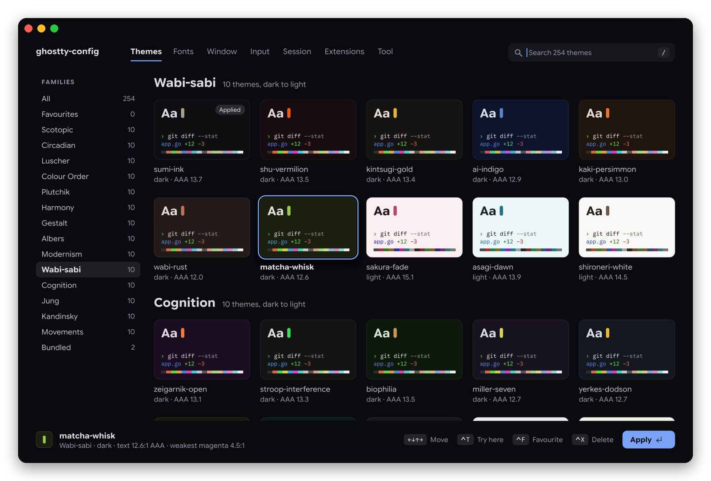
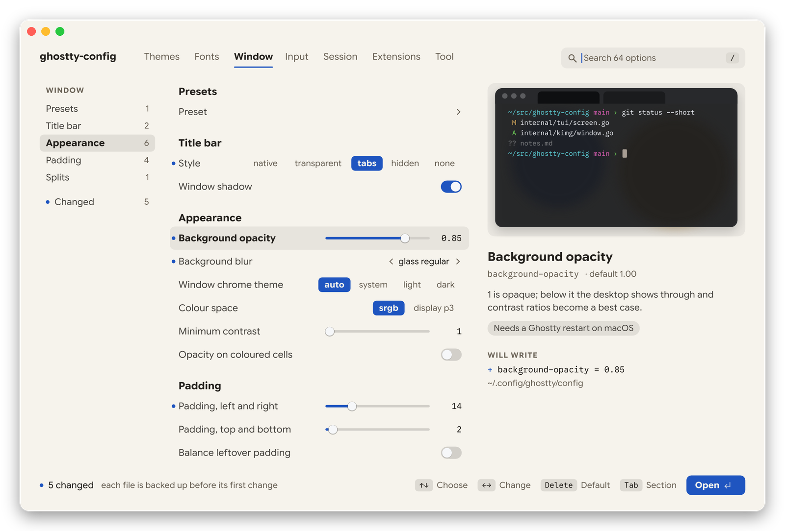

<p align="center"></p>

<h1 align="center">ghostty-config</h1>

<p align="center">Themes, fonts, window and input settings for <a href="https://ghostty.org">Ghostty</a>, in a full-screen interface inside the terminal.<br>A single binary, installed with one command: no Go, no git, no dependencies.</p>

<p align="center">
  <a href="#install"></a>
  <a href="https://github.com/vitruves/ghostty-config/tags"></a>
  
  <a href="LICENSE"></a>
</p>

<p align="center">
  
</p>

## Install

**One command. No Go, no git, no dependencies.**

```bash
curl -fsSL https://ghostty-config.vitruves.workers.dev/install.sh | sh
```

The script downloads a single binary for your system (macOS or Linux, Intel or ARM, any distribution), verifies its checksum and puts it in `~/.local/bin`. It sends nothing; the installs badge counts downloads of the script. On any other system it builds from source, which does need `git` and Go.

From source:

```bash
git clone https://github.com/vitruves/ghostty-config.git && cd ghostty-config
make build && make local-install
```

## Use

Run `ghostty-config`. Browsing never changes anything: a theme is written when you press `Enter` on it, and a setting when you change its value.

<div align="center">

| Key | Action |
| :---: | :--- |
| `Tab` | Next section |
| `↑` `↓` | Move through the list |
| `←` `→` | Change the highlighted setting |
| `Delete` | Reset the setting to Ghostty's default |
| `Enter` | Apply the theme, or open the setting's full list of values |
| `/` or type | Search themes, settings and commands |
| `Ctrl+T` `Ctrl+F` | Try a theme in this terminal; star it |
| `F1` `Esc` | Help; go back, then quit |

</div>

Everything can also be clicked. Click a section, a family or a setting to go to it. Click a pill, a switch or a point on a slider to set its value. Double-click a theme card to apply it, and use the wheel to scroll.

<p align="center">
  
</p>

## Sections

- **Themes:** 252 curated themes in 27 families, plus your own and the ones Ghostty ships, each shown as a card and checked for contrast. You can create, edit and save themes.
- **Fonts:** family, style, size, spacing and ligatures. Fonts that are not installed can be downloaded from Nerd Fonts.
- **Window:** title bar, opacity, blur and padding, with a preview of the window.
- **Input and Session:** cursor, clipboard, mouse, keyboard, scrollback, notifications and window restore.
- **Extensions:** shaders and theme packs, with their source and licence shown before anything is installed.
- **Tool:** reload Ghostty, change the interface's own colours, back up the config, show the paths in use.

## Good to know

- **Display.** In Ghostty and Kitty, the whole interface is drawn as images through the Kitty graphics protocol. Only the rows that change are redrawn, which takes a millisecond or two. Anywhere else, and inside tmux or screen, it is drawn with plain terminal text.
- **Your files.** Each setting is rewritten on the line where it is defined, and comments are kept. Every file is backed up to `~/.config/ghostty-config/backups/` before its first change.
- **Reload.** On macOS the tool sends Ghostty its reload shortcut, which needs the Accessibility permission. Elsewhere, reload Ghostty yourself.
- **Updates.** At most once an hour the tool checks GitHub for a new release, in the background. When there is one, a dialog offers to install it: **Install** downloads the binary for your system, checks its checksum and replaces the current one, and **Next time** leaves things as they are. The network is used for nothing else, apart from downloads you ask for. `-no-update-check` turns the check off.

## Options

```
-config file            edit this file instead of the default config
-themes dir             user themes directory
-cells                  draw the interface with terminal text, keeping images for theme cards
-no-images              never draw images
-images                 draw images even where the terminal is not known to support them
-plain                  use only characters every terminal can draw
-no-reload              never ask Ghostty to reload
-no-update-check        never check GitHub for a new release
-export-collection dir  write the curated themes to a directory and exit
-paths                  print the files that are read and written
-version                print the version
```

## Credits

[Ghostty](https://github.com/ghostty-org/ghostty) is by Mitchell Hashimoto and its contributors. Shaders come from [KroneCorylus/ghostty-shader-playground](https://github.com/KroneCorylus/ghostty-shader-playground) and [0xhckr/ghostty-shaders](https://github.com/0xhckr/ghostty-shaders). The interface is set in Google Sans Flex and Google Sans Code (SIL OFL).

MIT licence.
